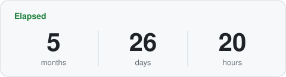

<!-- CLOCK:START -->
<picture>
  <source media="(prefers-color-scheme: dark)" srcset="assets/clock-dark.svg">
  
</picture>
<!-- CLOCK:END -->

## How to run

```
python3 -m unittest discover -s tests
CLOCK_START=2020-01-15T09:30:00 CLOCK_TZ=America/Los_Angeles python3 counter.py --card
```
